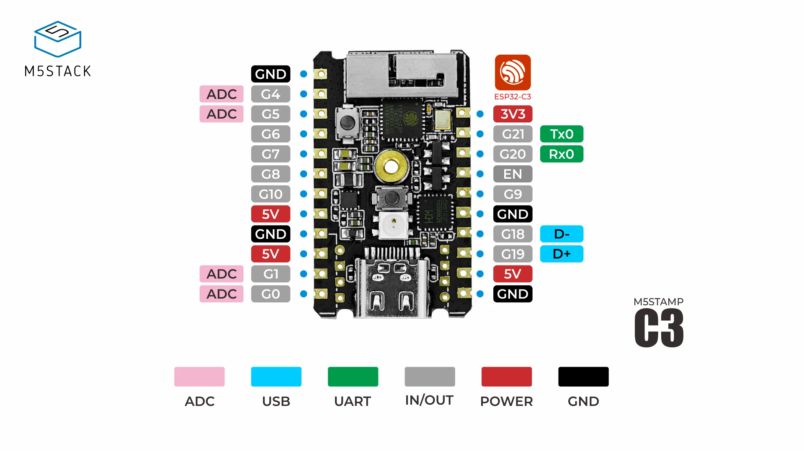

# GPIO

This document describes GPIO and their purpose.

## M5Stamp C3

Please refer M5STACK official documents to refer the original and newest version of image.

URL: https://docs.m5stack.com/en/core/stamp_c3

GPIO purpose of M5Stamp C3.

| GPIO | Controller node | direction |
|--|--|--|
| G0  | ---          | ---    |
| G1  | ---          | ---    |
| G4  | ---          | ---    |
| G5  | SERVO_PWR_EN | Output |
| G6  | SERVO        | Output |
| G7  | ---          | ---    |
| G8  | ---          | ---    |
| G9  | ---          | ---    |
| G10 | ---          | ---    |
| G18 | ---          | ---    |
| G19 | ---          | ---    |
| G20 | ---          | ---    |
| G21 | ---          | ---    |

Note that polarity of SWITCH_BUTTON is low-active, other input ports are high-active.

| Output signal | Low | High | Note |
|--|--|--|--|
| SERVO_PWR_EN | Power off | Power on | --- |
| SERVO        | Motor off | Rotate   | PWM (pulse length: 0.5~2.5ms) |

GPIO pullup/pulldown voltage of M5Stamp C3.

| GPIO | INPUT PULLDOWN [V] | INPUT PULLUP [V] | INPUT (Hi-Z) [V] | OUTPUT LOW [V] | OUTPUT HIGH [V] |
|--|--|--|--|--|--|
| G0  | 0    | 3.52 |      | 0    | 3.52 |
| G1  | 0    | 3.52 |      | 0    | 3.52 |
| G4  | 0    | 3.52 |      | 0    | 3.52 |
| G5  | 0    | 3.52 |      | 0    | 3.52 |
| G6  | 0    | 3.52 |      | 0    | 3.52 |
| G7  | 0    | 3.52 |      | 0    | 3.52 |
| G8  | 2.72 | 3.52 | 3.6  | 0    | 3.52 |
| G9  | 3.36 | 3.52 | 3.52 | 0    | 3.52 |
| G10 | 0    | 3.52 |      | 0    | 3.52 |
| G18 | 0    | 3.52 |      | 0    | 3.52 |
| G19 | 0    | 3.52 |      | 0    | 3.52 |
| G20 | 3.52 | 3.52 | 3.52 | 2.16 | 3.52 |
| G21 | 0.72 | 3.52 | 3.52 | 0    | 3.44 |

Legends:

* INPUT PULLDOWN: `pinMode(n, INPUT_PULLDOWN);`
* INPUT PULLUP:   `pinMode(n, INPUT_PULLUP);`
* INPUT Hi-Z:     `pinMode(n, INPUT);`
* OUTPUT LOW:     `pinMode(n, OUTPUT); digitalWrite(n, LOW);`
* OUTPUT HIGH:    `pinMode(n, OUTPUT); digitalWrite(n, HIGH);`

